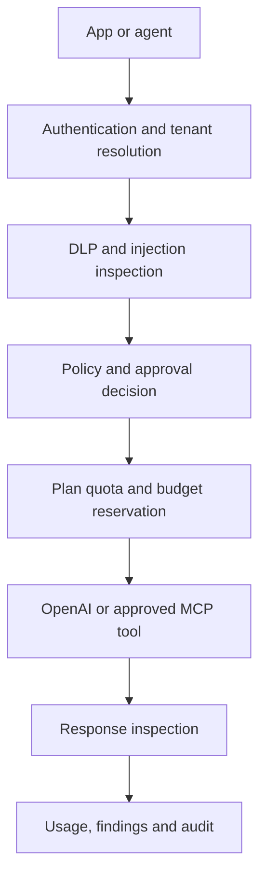

# NEXORA

AI Security, Governance & Control Plane

NEXORA sits between organizations and the models, applications, agents and MCP
tools they use. It applies deterministic security policy, sensitive-data
controls, budget admission, human approvals and audit logging before traffic is
sent to a model provider or remote tool.

> Release status: private release candidate. OpenAI execution, agent consent,
> MCP controls and Paddle-ready plan entitlements are implemented. Paddle
> checkout is intentionally disabled until a seller account, approved domain,
> products, prices and verified webhook destination are configured.

## What works

- Tenant-scoped Supabase authentication and row-level security.
- Native OpenAI Responses, Anthropic Messages and Google Gemini adapters, plus
  a bounded OpenAI-compatible adapter for additional vendors and private
  gateways.
- Request and response DLP, secret detection and prompt-injection checks.
- Versioned deterministic policies with block, redact, log and approval actions.
- Atomic budget and subscription-quota admission.
- Single-use, separation-of-duties human approvals.
- Explicit agent consent, scoped credentials, revocation and usage/cost totals.
- Native agent HTTP and MCP endpoints plus governed remote MCP invocation.
- Security fixtures, findings, request history, cost and audit views.
- Solo, Team and Enterprise plan records with server-enforced resource limits.

## Plans

| Plan | Price | Seats | Agents | Requests/month | Audit retention |
| --- | ---: | ---: | ---: | ---: | ---: |
| Solo | $49/month or $490/year | 1 | 3 | 25,000 | 30 days |
| Team | $249/month or $2,490/year | 10 | 25 | 250,000 | 180 days |
| Enterprise | From $1,500/month, annual contract | Contracted | Contracted | Contracted | Contracted |

Model-provider charges and custom implementation work are separate. New
organizations receive a 14-day Team trial.

## Architecture



Security decisions are deterministic server code. Models never decide the
policies that govern them.

## Requirements

- Node.js 24+
- A Supabase project
- At least one supported model-provider credential for live model execution
- Paddle account and approved domain for paid checkout (optional until billing is enabled)

## Server configuration

Required for the control plane:

```text
SUPABASE_URL
SUPABASE_PUBLISHABLE_KEY
SUPABASE_SERVICE_ROLE_KEY
```

Configure one or more model providers for live execution:

```text
OPENAI_API_KEY                  # OpenAI Responses API
ANTHROPIC_API_KEY               # Anthropic Messages API
GOOGLE_AI_API_KEY               # Google Gemini
NEXORA_<VENDOR>_API_KEY         # OpenAI-compatible vendor
NEXORA_<VENDOR>_BASE_URL        # required for compatible vendors
```

Optional remote MCP configuration:

```text
MCP_ALLOWED_ORIGINS=https://trusted-mcp.example
MCP_TOKEN_<SERVER_UUID>=server-bearer-secret
```

Paddle activation requires a client token, signed checkout secret, webhook
secret and four recurring price IDs. See [`docs/billing.md`](docs/billing.md).
Never put server secrets in `VITE_` variables.

## Local development

```bash
npm install
npm run dev
```

## Validation

```bash
npm run test:gateway
npm run test:security
npm run test:agents
npm run test:providers
npm run test:paddle
npm run test:billing
npm run test:database
npm run lint
npx tsc --noEmit
npm run build
```

The database test runs every repository migration in PGlite. It does not
replace live authentication, provider, Paddle sandbox, concurrency or browser
end-to-end testing.

## Deployment order

1. Apply every migration in `supabase/migrations`.
2. Configure server secrets.
3. Deploy the application from `main`.
4. Test a blocked request, redacted request and permitted OpenAI request.
5. Test agent consent, one-time credential exchange, usage totals and revocation.
6. Complete Paddle sandbox checkout and webhook lifecycle tests before enabling
   plan purchase buttons.

## Security boundaries

- Provider and agent credentials are server-only; raw agent credentials are
  returned once and stored only as SHA-256 digests.
- Database, policy, budget, audit and provider-readiness failures stop dispatch.
- DLP is heuristic and does not guarantee detection of every sensitive value.
- Timed-out provider calls retain reservations until reconciled because the
  upstream provider may have charged them.
- Remote MCP endpoints require a deployment allowlist, explicit tool approval
  and per-agent grants.

See [`docs/gateway-hardening.md`](docs/gateway-hardening.md) for detailed threat
boundaries and [`docs/billing.md`](docs/billing.md) for subscription controls.

## License

Private and proprietary. No license is granted for copying, redistribution or
production use outside the owner's organization.
